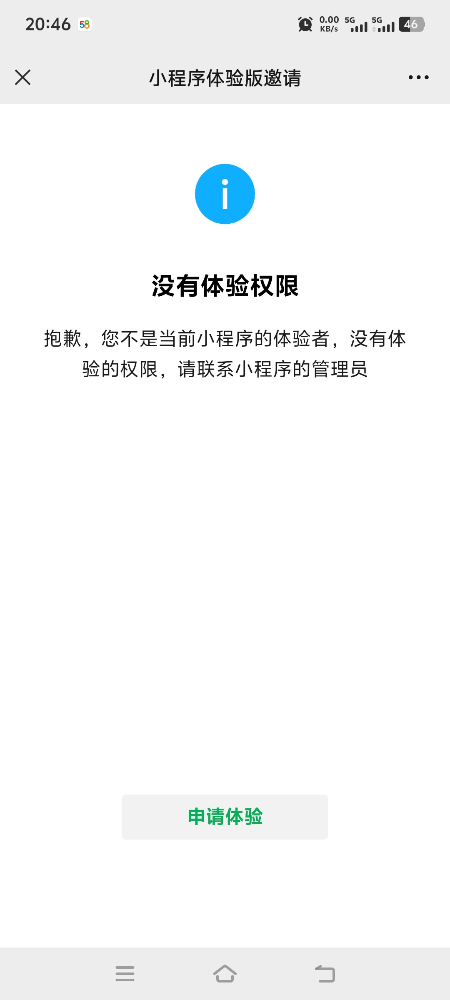
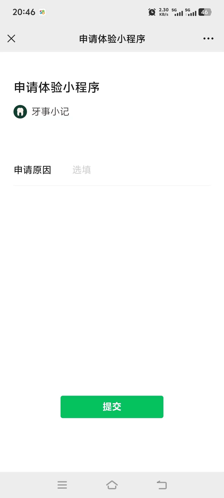
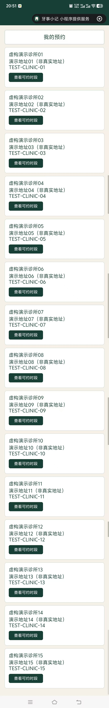

# 在线验收操作说明

陈杨娟｜信管2401班｜学号 1602240104

## 网页只读验收

打开[教师网页验收入口](https://203.195.214.159/login/?next=/appointments/b698d992-1074-428d-bbd4-f5c57c682795/)，使用以下课程演示账号登录。

- 账号 `teacher_course_review`
- 密码 `COBjMmXjifDwmUF9EMuq5OGVWpVA3Elf`

登录后会打开一笔虚构预约。点击「查看对应就诊」，再点击「查看结算单」，可核对 50.00 元、已支付和模拟现金。在线网页使用 2026 年 11 月 21 日验收版。下载源码可按仓库首页说明运行提交版。

## 微信小程序体验

「牙事小记」是基于安德鲁牙科连锁店案例设计的患者端。门店、人员及预约资料均为课程样例，结算不产生实际扣款。下方截图对应当前可扫码体验的界面。下载源码初始化后，门店显示「云杉路店」等名称，预约与结算的核对步骤相同。

### 第一步　用手机微信扫码

请扫描下方二维码，打开「牙事小记」课程体验版 0.1.0。二维码标注为 **2026 年 12 月 2 日前有效**。如已过期，请联系我获取新码。

### 第二步　首次扫码时申请体验

如果微信显示「没有体验权限」，请点页面下方的「申请体验」。进入申请页后，直接点「提交」，申请原因可以留空。我会在后台通过申请。通过后，请用同一个微信重新扫描二维码。如果扫码直接进入小程序，可跳到第三步。如果没有「申请体验」按钮，请联系我添加体验成员。

### 第三步　登录并查看样例结算

如小程序出现登录页，请使用下面的患者演示账号。

- 患者演示账号 `course_teacher_patient`
- 密码 `zEyuSQdfQATdUuh9MXMGQuuHs3qw`

在诊所列表顶部点「我的预约」，找到样例预约 `APT-20261121-2EB805678168`，打开结算单 `INV-20261121-6193D8DA5819`，核对 **50.00 元、已支付、模拟现金**。

查看诊所列表截图（「我的预约」在顶部）

演示账号由课程验收人员共享。请使用已有的虚构样例，不填写个人资料。
