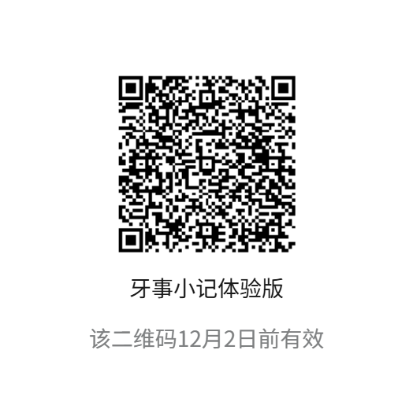

# 在线验收操作说明

陈杨娟｜信管2401班｜学号 1602240104

## 网页只读验收

打开[教师网页验收入口](https://203.195.214.159/login/?next=/appointments/b698d992-1074-428d-bbd4-f5c57c682795/)，使用以下课程演示账号登录。

- 账号 `teacher_course_review`
- 密码 `COBjMmXjifDwmUF9EMuq5OGVWpVA3Elf`

登录后会打开一笔虚构预约。点击「查看对应就诊」，再点击「查看结算单」，可核对 50.00 元、已支付和模拟现金。在线网页使用 2026 年 11 月 21 日验收版。下载源码可按仓库首页说明运行提交版。

## 微信小程序体验

请用手机微信扫描下方二维码，进入「牙事小记」课程体验版 0.1.0。二维码标注为 **2026 年 12 月 2 日前有效**。扫码后如出现「申请体验」，请提交申请，待管理员通过后重新打开。如提示无权限且没有申请入口，请联系我添加体验成员。二维码过期后，请联系我获取新码。

- 患者演示账号 `course_teacher_patient`
- 密码 `zEyuSQdfQATdUuh9MXMGQuuHs3qw`

进入「我的预约」，查找样例预约 `APT-20261121-2EB805678168`，打开结算单 `INV-20261121-6193D8DA5819`，核对 50.00 元、已支付和模拟现金。网页与小程序使用各自的演示账号。

演示账号由课程验收人员共享。请使用已有的虚构样例，不填写个人资料。
